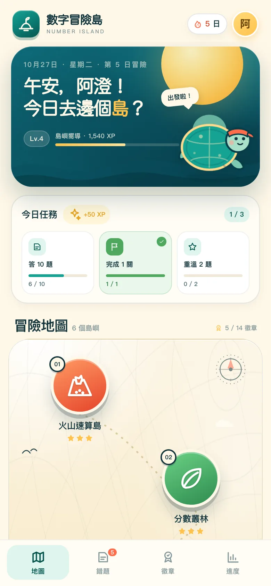

# 數字冒險島 · Number Adventure Island

> 玩住闖關，練好數學。A bilingual commercial site with a fully playable math game for P4–S3 students.

**▶ [Live website](https://s20250129-boop.github.io/banana/)** · [Play the game](https://s20250129-boop.github.io/banana/app/) · [Product design notes](產品設計.md) · [Website design notes](網站設計.md)



## The project

數字冒險島（Number Adventure Island）把數學練習變成 3–5 分鐘的島嶼冒險。學生自選島嶼與難度，答 6–8 題過關，取得星星、XP 與徽章；答錯的題目會自動進入錯題簿，可以隨時重練。

The project now has two layers:

- **`/`** — a bilingual (繁體中文 / English) commercial website: product story, six-island overview, live demo, learning design, curriculum, plans, author and FAQ.
- **`/app/`** — the original playable game, preserved in full and embedded in the site's live-demo modal. It can also be opened directly.

**Author / 作者：2A 余卓烽**

## What's inside

### Marketing site
- Responsive one-page site with a language switch (中 / EN), persisted in `localStorage` and shareable with `?lang=en`.
- Hero, problem framing, six-island cards, interactive live demo, screenshot gallery, learning design, curriculum coverage, progress, plans, author, FAQ and final CTA.
- SEO metadata, Open Graph/Twitter image, JSON-LD `EducationalApplication`, `robots.txt`, `sitemap.xml` and a branded `404.html`.
- Accessible focus states, reduced-motion support, semantic landmarks, mobile menu and a focus-managed demo modal.
- No cookies, no analytics, no tracking.

### Game
- **6 islands**: 四則運算、分數、圖形與度量、應用題、代數、數據與概率.
- **3 difficulty levels**: 探索 6 題、挑戰 8 題、極限 8 題.
- **4 hearts / 3 stars**: 4 misses end a run; 3 stars for at most 1 mistake.
- **14 badges**, daily quests, streak, XP/levels and a 7-day progress chart.
- **Mistake notebook**: automatic capture, filters, worked explanations, review runs and “mastered” marking.
- **Local-first**: progress is stored in `localStorage`; no account or backend.

## Structure

```
.
├── index.html                 # bilingual marketing site
├── 404.html
├── robots.txt / sitemap.xml
├── assets/
│   ├── site.css / site.js     # site design + bilingual copy + interactions
│   ├── img/                   # WebP app screenshots
│   ├── og-cover.png
│   └── favicon.svg
├── app/index.html             # built playable game
├── src/                       # game source (CSS / JS split)
├── build.py                   # game: src/ → app/index.html
├── build_site.py              # game build + assemble public site/
├── 產品設計.md                 # game/product design notes
├── 網站設計.md                 # commercial website design notes
└── .github/workflows/         # GitHub Pages deployment
```

## Run locally

```bash
# Build the game and the public site
python3 build_site.py

# Serve the repo root (marketing site + /app/)
python3 -m http.server 8000
# open http://localhost:8000
```

The game also works as a single offline file: `app/index.html`. Opening the marketing site via `file://` works for reading, but the `/app/` demo is best tested through a local server.

## Deployment

The GitHub Actions workflow [`.github/workflows/deploy-pages.yml`](.github/workflows/deploy-pages.yml) runs on every push/merge to `main`:

1. Checks out the repo.
2. Runs `python3 build_site.py` to rebuild the game and assemble `site/`.
3. Uploads `site/` as the GitHub Pages artifact.
4. Deploys with `actions/deploy-pages`.

The public site is <https://s20250129-boop.github.io/banana/>.

## Language note

The marketing website, FAQ and learning guide are fully bilingual. The playable prototype's in-game text is currently Traditional Chinese; an English game UI is on the roadmap. Math notation and the game mechanics are language-independent.

## Privacy

No cookies, no tracking, no account. Progress is stored only in the browser's `localStorage`. Clearing browser data resets progress. The demo on the site uses the same local storage as `/app/`.

## Author

**2A 余卓烽** — 產品設計、介面、題目引擎、網站與部署。
Form 2A student from Hong Kong. Built the concept, interface, question engine, website and deployment.

- GitHub: [@s20250129-boop](https://github.com/s20250129-boop)
- Design notes: [產品設計.md](產品設計.md)

## Status

This is an interactive prototype, not a production SaaS. Questions are generated algorithmically; the next steps are a teacher-reviewed question bank, spaced repetition, family sync, a teacher view and English game content. See the design notes for details.
