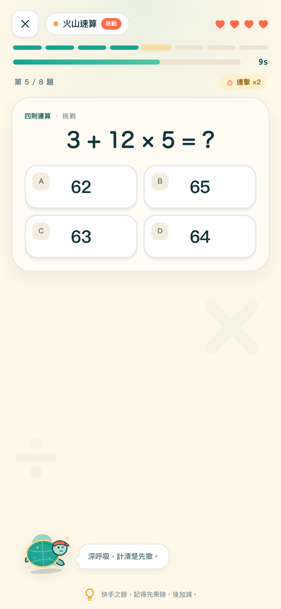
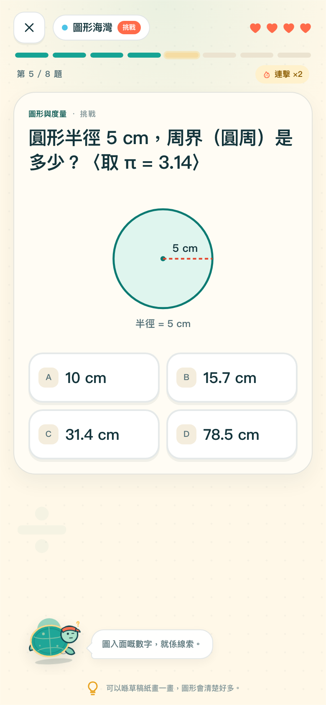
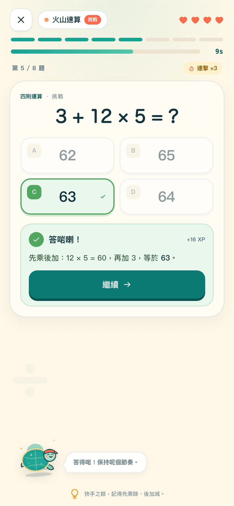
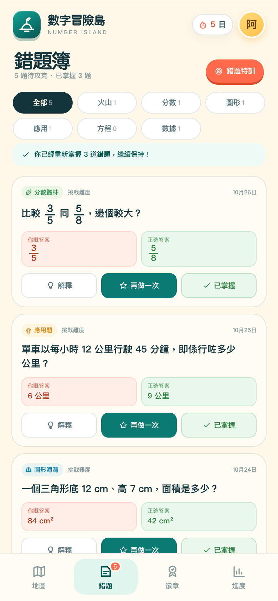
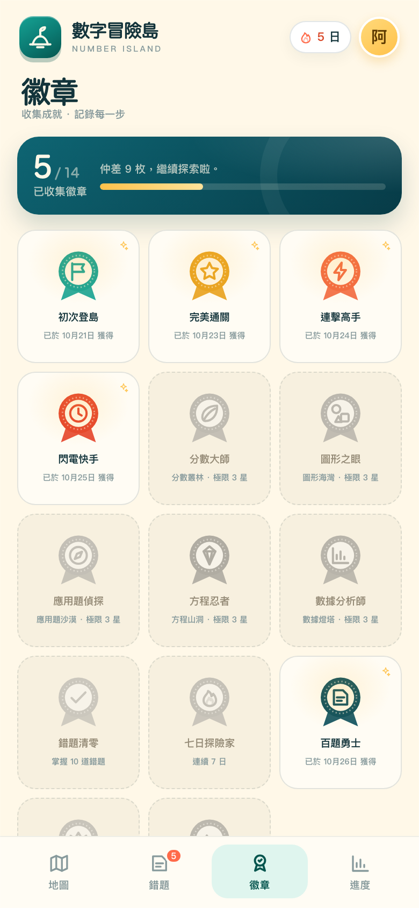
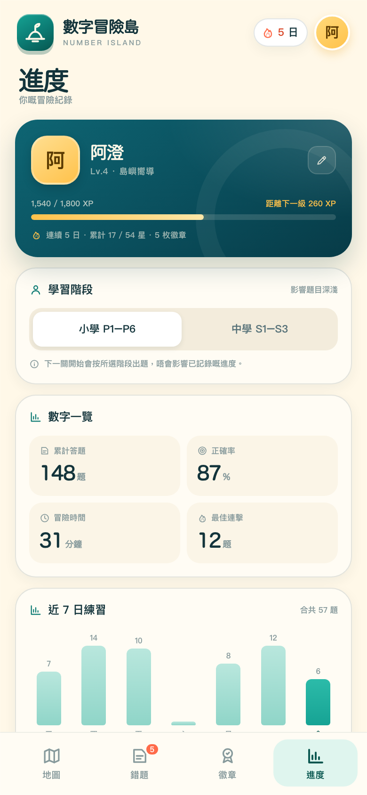

# 數字冒險島 · 產品設計筆記

> 與其叫學生「再做十題」，不如俾佢揀一個島，打一場冒險。

> 商業網站層已加入：`index.html`（中英雙語網站）＋ `app/`（完整可玩遊戲）。作者：2A 余卓烽。網站設計見 `網站設計.md`。

---

## 0. 快速試玩

- 直接打開 `index.html`，唔需要安裝、唔需要網絡、冇外部字體或圖片。
- 第一次打開會載入一個**示範進度**（阿澄，Lv.4，5 日連續冒險，5 枚徽章，5 道未攻克錯題），方便即刻看到完整體驗。
- 想由零開始：**進度 → 重設進度**。
- 想試中學題目：**進度 → 學習階段 → 中學 S1–S3**，下一關開始生效。
- 建議用 Chrome / Edge 開啟；`file://` 模式下 Safari 有時會限制 `localStorage`，進度可能無法保留。

**原型包含**

| 功能 | 狀態 |
|---|---|
| 六個島嶼、三種難度 | ✅ 可玩 |
| 四則運算、分數、圖形、應用題、代數、數據 | ✅ 即時生成題目 |
| 星數、XP、等級、連擊、四顆心 | ✅ |
| 14 枚徽章、解鎖動畫 | ✅ |
| 錯題自動記錄、篩選、重練、標記掌握 | ✅ |
| 每日任務、連續冒險日數 | ✅ |
| 7 日練習圖表、島嶼掌握度 | ✅ |
| 小學／中學題目切換 | ✅ |
| 音效、減少動態、重設 | ✅ |
| 帳號、雲端同步、家長／老師後台 | ❌ 刻意留白 |

### 預覽

| 冒險地圖 | 島嶼關卡 | 火山速算 |
|---|---|---|
|  |  |  |
| **圖形海灣** | **完美通關** | **答題回饋** |
|  |  |  |
| **錯題簿** | **徽章牆** | **進度** |
|  |  |  |

### 檔案結構

```
數字冒險島-v2/
├── index.html          ← 單一檔案、離線可玩（主要交付）
├── 產品設計.md          ← 本文件
├── 預覽/               ← 9 張 390×844（@2x）手機截圖
├── src/                ← 可維護的原始碼（CSS / JS 分檔）
└── build.py            ← 將 src/ 打包成 index.html
```

> `index.html` 已經包含所有 CSS、JS、SVG，唔需要 build 都可以直接打開。`src/` 只係方便日後修改；改完執行 `python3 build.py` 重新打包。

---

## 1. 一句定位

**一個把數學練習變成 3–5 分鐘島嶼冒險的遊戲化練習工具：自選島嶼與難度，答題過關，收集徽章，錯題自動變成下一次練習。**

它不是另一個「題庫 App」，而是一個**有明確起點與終點的小型冒險**：每次只做 6–8 題，完成後一定有一個結果、一點獎勵、一個下次可以再做嘅理由。

---

## 2. 用戶與問題

### 主要用戶

- **小四至中二學生**：有基本數學基礎，開始覺得練習重複、沉悶；放學後時間零碎，手機係主要裝置。
- **想幫手但唔想逼得太緊嘅家長**：想知仔女有冇練、邊方面弱，但唔想坐喺隔籬監察。
- **老師／補習導師**：想快速知道學生邊類題型錯得最多，但唔想多一個複雜系統。

### 核心痛點

1. **練習冇目標**：做十題同做二十題冇分別，做完只係「做完」。
2. **錯咗唔知點解**：對答案之後，錯題就散喺練習冊或截圖入面，下次唔會再遇到。
3. **怕錯、怕比較**：公開排名同分數令學生揀最安全嘅題目，甚至避開數學。
4. **難度唔啱**：太淺悶、太深挫敗；學生冇能力自己揀「啱啱好」嘅挑戰。
5. **家長資訊斷裂**：唔知進步定退步，只見到「有冇做」。

### 設計機會

> 將「練習量」換成「一次可控嘅挑戰」；將「錯題」由羞恥變成**下次冒險嘅線索**。

---

## 3. 學習設計原則

| 原則 | 在產品入面點樣體現 |
|---|---|
| **Retrieval practice（提取練習）** | 每次都要學生自己揀答案／輸入答案，唔係睇解釋。 |
| **Immediate feedback** | 答完即刻顯示啱／錯、正確答案同**簡短解題步驟**。 |
| **Mastery learning** | 錯題重練答啱先會標記「已掌握」；唔係做過就當識。 |
| **Spaced review（下一階段）** | 錯題會保留，之後可按 1／3／7 日排程重現；原型先用「手動重練」。 |
| **Desirable difficulty** | 三層難度：探索、挑戰、極限；同一課題有明顯遞進。 |
| **Autonomy** | 學生自己揀島、揀難度、揀幾時停；冇被系統強制升級。 |
| **Growth mindset** | 錯題用「仲未掌握」而唔係「你唔識」；四顆心、失敗可以即刻再嚟。 |
| **Short session** | 一關 6–8 題，約 3–5 分鐘，適合搭車、小息、睡前。 |
| **Low-stakes** | 冇公開排名、冇同儕比較，只有自己嘅最佳紀錄。 |

**一句話**：遊戲化係為了令學生**願意再做一次提取**，唔係為了令佢停留在遊戲。

---

## 4. 核心循環

```
        ┌─────────────────────────────────────────┐
        │  揀島嶼（六個課題）                      │
        │      ↓                                  │
        │  揀難度（探索／挑戰／極限）              │
        │      ↓                                  │
        │  6–8 題 · 即時回饋 · 四顆心              │
        │      ↓                                  │
        │  星數 + XP + 連擊 + 徽章                 │
        │      ↓                                  │
        │  錯題自動入簿 → 錯題特訓 → 標記掌握      │
        │      ↓                                  │
        │  每日任務 / 連續日數 / 下一島解鎖        │
        └─────────────────────────────────────────┘
```

**一次完整循環應該喺 5 分鐘內完成**，並且一定有「下一次」嘅入口：再玩一次、返錯題簿、或者去下一個島。

---

## 5. 六個島嶼

| 島嶼 | 課題 | 主要互動 | 難度遞進例子 |
|---|---|---|---|
| **火山速算島** | 四則運算 | 限時四選一；16／13／11 秒 | 20 以內加減 → 兩位數混合運算 → 百分比、次方、括號 |
| **分數叢林** | 分數 | 分數條視覺＋四選一 | 同分母比較 → 異分母加減、等值 → 乘法、除法、化簡 |
| **圖形海灣** | 圖形與度量 | SVG 圖形＋四選一 | 長方形面積／周界 → 三角形、平行四邊形、圓周 → 圓面積、梯形、體積、畢氏定理 |
| **應用題沙漠** | 應用題 | 自訂數字鍵盤輸入 | 購物找續、分組 → 平均數、折扣、速率 → 百分比增減、工程、利息、利潤 |
| **方程山洞** | 代數 | 方程石板＋數字鍵盤 | 找未知數 → 兩步方程 → 括號、兩邊有 x、分數方程 |
| **數據燈塔** | 數據與概率 | 長條圖／概率＋四選一或輸入 | 讀圖表 → 平均數、範圍、眾數、概率 → 中位數、缺失值、轉盤概率 |

### 5.1 唔係六款獨立街機遊戲

呢個原型嘅「小遊戲」係**六種題型玩法**：限時選擇、視覺分數、圖形判斷、數字輸入、方程輸入、圖表閱讀。佢哋共享同一個答題引擎、獎勵系統同錯題系統，所以：

- 內容覆蓋夠廣，唔會玩兩日就冇題；
- 學習數據可以橫向比較（同一個學生喺六個課題嘅掌握度）；
- 開發成本可控，適合作為 MVP。

下一階段可以為每島加入更強嘅遊戲機制（例如火山嘅熔岩計時、分數叢林嘅切割動畫），但**唔應該為咗玩法而犧牲題目質素**。

---

## 6. 難度、星數與進度

### 6.1 三種難度

| 難度 | 題數 | 估計時間 | 定位 |
|---|---|---|---|
| **探索** | 6 | 約 3 分鐘 | 熱身、建立信心 |
| **挑戰** | 8 | 約 4 分鐘 | 混合題型、真正考驗 |
| **極限** | 8 | 約 5 分鐘 | 進階題目、衝 3 星 |

所有難度一開始就開放。**唔用「未夠班」鎖住高難度**，因為：
- 學生最清楚自己今日想挑戰幾多；
- 鎖難度會傳遞「你未夠好」嘅訊息；
- 家長／老師可以按需要建議，而唔係系統硬性標籤。

### 6.2 四顆心

每關有 **4 顆心**，答錯或超時扣一顆；扣到 0 就中止。設計原因：

- 比「三顆心」寬容，容許學生試錯；
- 但仍然有明確失敗點，令選擇有意義；
- 4 次失誤才中止，足夠讓 1 星結果出現（見下）。

### 6.3 星數

| 結果 | 星數 |
|---|---|
| 錯 0–1 題 | ★★★ |
| 錯 2 題 | ★★☆ |
| 錯 3 題 | ★☆☆ |
| 錯 4 題（四心耗盡）或正確率 < 40% | 0 星，需再試 |

3 星唔要求「全對」，而係「最多錯一題」——對中小學生嚟講，呢個係**有挑戰但可達到**嘅標準。1 星亦真正可達（錯 3 題、剩 1 顆心完成）。

### 6.4 島嶼解鎖

- 第一個島（火山速算）預設開放。
- 之後每個島，需要**上一個島任何難度取得最少 1 星**才解鎖。
- 已解鎖島嶼唔會再鎖返。
- 地圖上用虛線路徑、島嶼編號、「你喺度」標記，令進度一目了然。

### 6.5 XP 與等級

一次冒險嘅 XP：

```
答對 × 10
+ 最高連擊 × 2（連擊上限 10 題，即最多 +20）
+ 星數 × 15
+ 完成獎勵 10（有星）
+ 首次通關 20
+ 每日任務全清 50
```

等級門檻：`0 / 300 / 700 / 1,200 / 1,800 / 2,500 / 3,300 / 4,200...`
稱號：見習探險家 → 島嶼嚮導 → 數學船長 → 傳說航海家 → 群島守護者。

XP 嘅作用係**累積感**，唔係解鎖功能；冇「課金加速」。

### 6.6 連擊與計時

- **連擊**：連續答對會顯示 ×2、×3…，每一題額外 +2 XP（上限 +20）。答錯即歸零。
- **計時只在火山速算**：因為「快而準」就係嗰個島嘅學習目標。其他島**唔加倒數**，避免將「數學焦慮」擴散到所有題型。呢個係刻意嘅差異化。

### 6.7 每日任務與連續日數

每日三個任務：

1. 答 10 題
2. 完成 1 關
3. 重溫 2 道錯題

全清 +50 XP。連續日數（streak）只作顯示，**唔會用 push 通知或「斷 streak」懲罰**；原型冇通知權限。

---

## 7. 徽章系統（14 枚）

| 徽章 | 解鎖條件 | 設計意圖 |
|---|---|---|
| 初次登島 | 完成第一個關卡 | 最低門檻，第一次成功 |
| 完美通關 | 一關 0 失誤 | 獎勵精準 |
| 連擊高手 | 連續答對 10 題 | 獎勵穩定表現 |
| 閃電快手 | 火山速算 3 星 | 對應限時玩法 |
| 分數大師 | 分數叢林 · 極限 3 星 | 課題精通 |
| 圖形之眼 | 圖形海灣 · 極限 3 星 | 課題精通 |
| 應用題偵探 | 應用題沙漠 · 極限 3 星 | 課題精通 |
| 方程忍者 | 方程山洞 · 極限 3 星 | 課題精通 |
| 數據分析師 | 數據燈塔 · 極限 3 星 | 課題精通 |
| 錯題清零 | 掌握 10 道錯題 | 獎勵修正，而不只是做新題 |
| 七日探險家 | 連續 7 日 | 建立習慣 |
| 百題勇士 | 累計答對 100 題 | 長期累積 |
| 群島之主 | 六個島各最少 2 星 | 全科平衡 |
| 逆轉勝 | 失敗後同一關再取得 3 星 | 獎勵韌性 |

**設計原則**

- 徽章描述**行為**，唔係描述「聰明」。
- 有「精通型」（極限 3 星）、「努力型」（百題）、「修正型」（錯題清零）、「韌性型」（逆轉勝），避免只有「快」同「高分」嘅人拿到獎勵。
- 徽章牆用鎖定狀態展示條件，令學生知道「下一步可以做咩」。

---

## 8. 錯題系統

### 8.1 自動收集

答錯或超時，系統自動記錄：

- 題目 snapshot（文字、選項、圖形、正確答案、解釋）
- 學生答案
- 島嶼、難度、日期
- 重試次數
- 是否已掌握

**唔需要學生手動「加入錯題」**——呢個決策減少一個步驟，換取更高使用率。

### 8.2 錯題簿

- 顯示未掌握錯題，可按島嶼篩選。
- 每張卡顯示「你嘅答案 / 正確答案」，撳「解釋」展開解題思路。
- 「再做一次」會進入**錯題特訓**（最多 6 題），答啱即時標記掌握。
- 「已掌握」容許手動標記（例如學生喺紙上再算一次）。
- 已掌握數量會顯示，形成「清空錯題」嘅進度感。

### 8.3 下一階段：間隔重複

原型先用「手動重練」。正式版建議：

- 錯題首次重現：+1 日
- 答啱：+3 日 → +7 日 → +14 日
- 答錯：回到 +1 日
- 每次重練只問 1–2 題，避免一次過堆積
- 區分錯誤類型：概念錯、步驟錯、粗心；不同類型用不同提示

---

## 9. 資訊架構

```
數字冒險島
├── 地圖（首頁）
│   ├── 今日任務
│   ├── 六個島嶼節點
│   └── 島嶼詳情（bottom sheet）
│       └── 三種難度 → 開始冒險
├── 答題（全螢幕）
│   ├── 進度、心、計時、連擊
│   ├── 題目／圖形／選項或鍵盤
│   ├── 提示
│   └── 即時回饋 → 下一題
├── 結算（全螢幕）
│   ├── 星數、XP、統計
│   ├── 新徽章、新島解鎖
│   └── 再玩一次 / 返回地圖
├── 錯題簿
│   ├── 篩選
│   ├── 錯題卡（解釋 / 再做一次 / 已掌握）
│   └── 錯題特訓
├── 徽章
│   ├── 收集進度
│   ├── 徽章牆
│   └── 徽章詳情
└── 進度
    ├── 個人檔案、等級
    ├── 學習階段（小學／中學）
    ├── 數字一覽
    ├── 近 7 日練習
    ├── 島嶼掌握度
    └── 設定（音效、動態、重設）
```

**導航原則**

- 四個底部目的地：地圖、錯題、徽章、進度。
- 答題同結算係全螢幕，唔顯示底部導航，避免中途跳走。
- 島嶼詳情用 bottom sheet，保留地圖上下文。
- 任何時候都有明確「返回」或「X」。

---

## 10. 關鍵設計決策

### 10.1 用「島嶼」包裝課題，而唔係用課題列表

「分數」聽起來係功課；「分數叢林」聽起來係一個地方。地圖嘅空間隱喻同時提供：
- 進度感（由左至右、由下至上）
- 解鎖感（下一個島）
- 選擇感（今日去邊個島）

### 10.2 四顆心，而唔係三顆

三星制度需要「錯 3 題仍可完成」嘅空間；三顆心會令 1 星永遠不可能出現。四顆心亦更適合中小學生：錯咗仲有機會補救，唔會一開始就覺得「今次玩完」。

### 10.3 計時只放喺火山

如果每一題都倒數，數學練習會變成反應遊戲，學生會避開需要思考嘅題目。將時間壓力限制喺「速算」呢個本身就講求流暢度嘅島，其他島讓學生慢慢諗。

### 10.4 答錯一定解釋，而且唔急住跳走

回饋卡會顯示正確答案同**簡短步驟**；學生要撳「繼續」先走。呢個「停留」係刻意嘅：如果自動跳下一題，學生只會記得「錯」，唔會記得「點解」。

### 10.5 錯題自動入簿

唔要求學生自己整理錯題。對中小學生嚟講，最需要嘅係「下次一定會再見到」，而唔係多一個整理工具。

### 10.6 冇排行榜

- 避免同儕比較同標籤；
- 讓學生可以安全地試高難度；
- 家長／老師需要嘅係「邊方面弱」，唔係「排第幾」。

### 10.7 本地優先、冇帳號

原型所有資料只存 `localStorage`：
- 唔需要 Email／電話／出生日期；
- 唔會上傳學生答案；
- 開啟即玩，冇 onboarding 阻力。

代價係換裝置會失去進度；正式版可以用「無帳號同步碼」或家長帳號解決，但要先處理兒童私隱同監護人同意。

### 10.8 難度透明，但唔標籤學生

學生自己揀「探索／挑戰／極限」，系統唔會顯示「你只適合探索」。難度係**今日嘅選擇**，唔係**能力嘅標籤**。

### 10.9 廣東話語氣，但數學術語用標準中文

- 介面用「你」、「唔使急」、「答啱喇」等香港學生熟悉嘅語氣。
- 數學術語保留「分子」、「分母」、「周界」、「平均數」等標準寫法，避免影響課堂銜接。
- 解釋簡短，唔用過度可愛嘅句子遮蓋數學。

### 10.10 阿龜：一個唔會評判你嘅教練

吉祥物唔會嘲笑、唔會催、唔會說「你又錯」。佢只會：
- 喺開場陪住你；
- 答啱時慶祝；
- 答錯時講「唔緊要，錯咗先知道邊度要練」；
- 喺答題頁提醒「深呼吸，計清楚先撳」。

---

## 11. 視覺設計

### 11.1 色彩

| 角色 | 顏色 |
|---|---|
| 深海 | `#073B47` / `#0A4E5C` |
| 冒險綠 | `#16A394` / `#0B7A72` |
| 珊瑚（行動） | `#FF6B4A` |
| 芒果（獎勵） | `#FFC24B` |
| 沙紙（背景） | `#FFF8E8` / `#FFFCF4` |
| 墨綠（文字） | `#13343B` |

地圖用沙色紙張＋等高線，內容卡用米白，獎勵用珊瑚／芒果。六個島各有自己的主色，但共享同一個「冒險」色系，唔會變成彩虹拼貼。

### 11.2 字體與排版

- 系統字體（PingFang HK／Noto Sans HK），冇外部字體請求。
- 標題用較重字重同負字距，營造「遊戲標題」感；內文保持易讀。
- 數字用 tabular numerals，答題時唔會跳位。
- 分數用真正的上下分數排版（CSS inline-flex），唔係 `3/4` 字串。

### 11.3 插畫

- 所有插畫係 inline SVG：島嶼圖示、阿龜、徽章、地圖指南針、幾何圖形、長條圖。
- 好處：離線、可縮放、冇版權問題、可以跟主題色變化。
- 阿龜用簡單幾何形狀：龜殼、頭、bandana、表情；表情有 happy／cheer／oops／think，配合答題狀態。

### 11.4 動態

- 地圖節點有輕微浮動／脈衝；阿龜有呼吸動畫。
- 答對：綠框、打勾、XP 飄出；答錯：紅框、搖動、阿龜 oops。
- 結算：星星逐粒彈出、彩紙、徽章光暈。
- 全部尊重 `prefers-reduced-motion`，設定頁亦可關閉。

### 11.5 裝置與可及性

- 390 × 844 手機比例；桌面顯示為置中手機殼，外圍有品牌背景。
- 所有操作目標最少 35–44px；主要按鈕 50px。
- 顏色以外，正確／錯誤同時用圖示、文字同邊框表示。
- 焦點環、`aria-label`、`aria-live` 嘅 toast；鍵盤可用 1–4／A–D 答選擇題、數字鍵輸入。
- 未做完整 screen reader 焦點管理同 modal focus trap；正式版需補。

---

## 12. MVP 範圍

| 功能 | 這一版 | 說明 |
|---|---|---|
| 六島 × 三難度 | ✅ | 演算法生成題目，覆蓋小學至初中 |
| 小學／中學切換 | ✅ | 影響下一關題目深淺 |
| 星數、XP、等級、連擊、心 | ✅ | 完整結算 |
| 14 枚徽章 | ✅ | 包含課題精通、錯題、連續、韌性 |
| 錯題簿 | ✅ | 自動收集、篩選、解釋、重練、掌握 |
| 每日任務 | ✅ | 3 個任務 + 50 XP |
| 7 日圖表、掌握度 | ✅ | 本地統計 |
| 示範進度 | ✅ | 方便第一次打開就看到完整狀態 |
| 音效／動態開關 | ✅ | Web Audio；可完全關閉 |
| 帳號／雲端 | ❌ | 本地優先 |
| 家長／老師後台 | ❌ | 下一階段 |
| 自動調適難度 | ❌ | 現在由學生自選；未來可按表現建議 |
| 間隔重複排程 | 🟡 | 錯題已保留，排程未做 |
| 手寫辨識／拍照出題 | ❌ | 與核心循環無關，暫不加入 |

---

## 13. 資料模型（概念）

```json
{
  "player": {
    "name": "阿澄",
    "stage": "primary",
    "xp": 1540,
    "streak": 5,
    "lastActive": "2026-10-27",
    "createdAt": "2026-10-20T08:00:00.000Z"
  },
  "islands": {
    "fraction": {
      "stars": { "1": 3, "2": 2, "3": 1 },
      "plays": 5,
      "bestCombo": 9,
      "failed": { "3": true }
    }
  },
  "stats": {
    "answered": 148,
    "correct": 129,
    "timeSec": 1860,
    "bestCombo": 12,
    "runs": 9,
    "perfectRuns": 1,
    "comeback": 0,
    "days": {
      "2026-10-27": { "answered": 6, "correct": 5, "minutes": 3 }
    }
  },
  "badges": {
    "first": "2026-10-21T08:10:00.000Z"
  },
  "mistakes": [
    {
      "id": "m_x",
      "q": {
        "kind": "choice",
        "island": "fraction",
        "diff": 2,
        "prompt": "比較 3/5 同 5/8，邊個較大？",
        "options": ["3/5", "5/8", "一樣大"],
        "answerIndex": 1,
        "explain": "交叉相乘…"
      },
      "yourHTML": "3/5",
      "correctHTML": "5/8",
      "attempts": 1,
      "mastered": false,
      "createdAt": "2026-10-26T10:20:00.000Z",
      "lastAt": "2026-10-26T10:20:00.000Z",
      "masteredAt": null
    }
  ],
  "daily": {
    "date": "2026-10-27",
    "answered": 6,
    "correct": 5,
    "cleared": 1,
    "reviewed": 0,
    "claimed": false
  },
  "settings": { "sound": true, "motion": true }
}
```

**正式版建議拆表**

- `players`
- `island_progress`（player_id, island_id, difficulty, best_stars, plays）
- `attempts`（每次答題：question_id, correct, time_ms, hint_used）
- `mistakes`（question snapshot / question_id, state, next_review_at）
- `badges`（player_id, badge_id, earned_at）
- `daily_activity`（player_id, date, answered, correct, minutes）

SQLite 作本地 cache；雲端同步以 `updated_at` + last-write-wins 處理衝突，或事件日誌。

---

## 14. 技術建議

### 14.1 原型（今次）

- 單一 `index.html`，內嵌 CSS + JS，冇 build step、冇外部依賴。
- 原生 JavaScript，函數式 render（每次狀態改變重繪 view）。
- inline SVG 插畫；Web Audio 音效；localStorage 存檔。
- 題目由 deterministic generator 即時產生，總共 6 島 × 3 難度 × 2 階段。

### 14.2 正式 MVP（建議）

**方案 A：Expo / React Native**

- 一套 codebase 出 iOS + Android。
- SQLite（expo-sqlite）作本地資料庫；React Query 管理狀態。
- 題目 JSON 由 CDN 下載，版本化，支援離線。
- 同步：Supabase / Firebase；匿名 device ID → 家長帳號升級。
- 好處：香港學生手機以 iOS/Android 為主，native 體驗最好。

**方案 B：Flutter**

- 適合想要高度自訂動畫同一致視覺嘅團隊；SQLite + Drift。
- 但香港市場 iOS 比例高，React Native 生態對 web prototype 過渡較順。

**唔建議**純 WebView 包裝：手感、離線、儲存同推送都會受限。

### 14.3 題目：生成 vs 題庫

原型用演算法生成，優點係無限題、容易調難度；缺點係：
- 題型pattern會重複；
- 難以完全對齊學校課程同考試問法；
- 解釋嘅變化有限。

正式版建議**混合**：

1. 核心題庫：由老師按香港課程（P1–S3）編寫同審核，標記 `topic / subtopic / difficulty / misconception`。
2. 生成器：用嚟產生同類變式，擴大練習量，但只喺已審核嘅模板內變數。
3. 難度校準：用真實答題數據估計每題難度，而唔係純靠作者感覺。
4. 解釋：每個 misconception 有針對性回饋，而唔係單一正確答案。

### 14.4 品質保證

- 每個 generator 要有單元測試：答案正確、選項唯一、無 `NaN/undefined`、分數化簡正確。
- 原型已做 fuzz test：6,480 題結構檢查、2,400 題分數運算檢查、1,364 條代數方程代入檢查，0 個錯誤。
- 正式版要加入老師抽樣審核同學生回報「題目有問題」。

### 14.5 私隱與兒童

- 原型：零個人資料，只有名字（可改）同本地進度。
- 正式版：
  - 預設匿名；帳號只在家長同意後建立。
  - 唔收集出生日期、學校、班別（除非老師後台明確需要）。
  - 唔賣資料、唔落廣告、唔用第三方追蹤。
  - 符合香港《個人資料（私隱）條例》及兒童私隱原則；如進軍其他市場，需 GDPR-K / COPPA 評估。
  - 家長／老師報告只顯示學習數據，唔顯示其他學生。

---

## 15. 成效指標

**North Star**：每週有 3 次以上「完成一次冒險」嘅活躍學生數。

| 層面 | 指標 | 目標（MVP 首 3 個月） |
|---|---|---|
| 啟動 | 第一次打開 → 完成第一關 | > 60% |
| 參與 | 每週冒險次數 | ≥ 3 |
| 留存 | D1 / D7 | > 40% / > 18% |
| 學習 | 同一課題 7 日後正確率提升 | +10–15 個百分點 |
| 修正 | 錯題 14 日內掌握率 | > 50% |
| 習慣 | 連續 7 日比例 | > 10% |
| 體驗 | 一關完成時間 | 3–6 分鐘 |
| 護欄 | 答錯後即刻離開比例 | < 15% |
| 護欄 | 四心耗盡比例 | < 20% |
| 護欄 | 提示使用率 | 10–30%（太低代表太難，太高代表太淺） |

**唔睇嘅虛榮指標**：總下載量、總答題數（可以靠刷）、平均 session 長度（越長唔一定越好）。

---

## 16. 路線圖

### 0–1 個月：驗證核心循環

- 用原型做 8–12 個學生測試（小四至中二）。
- 觀察：會唔會自己揀第二次？卡喺邊個位？四心會唔會太嚴？
- 調整：題目難度、解釋長度、星星門檻。

### 1–3 個月：MVP

- React Native + SQLite。
- 老師審核題庫（P4–S2 六個課題）。
- 錯題間隔重複。
- 家長摘要（每週一次，唔係即時監控）。
- 無帳號本地版 → 可選家長帳號同步。

### 3–6 個月：差異化

- 自適應難度建議（根據最近表現，而唔係自動鎖）。
- 更多互動：分數切割、圖形拼砌、方程天平。
- 語音朗讀題目（讀寫障礙支援）。
- 老師班級碼：只看班級整體弱項，不看排名。

### 6–12 個月：生態

- 課程對齊（香港 EDB 數學科課程指引）。
- 學校授權版 / 家長版。
- 開放題目模板比老師共創。
- 英文版（針對 EMI 學校）。

---

## 17. 風險與取捨

| 風險 | 影響 | 對策 |
|---|---|---|
| 遊戲化蓋過學習 | 學生只為徽章刷題 | 徽章條件包含精通與修正；題目必須作答；解釋不能跳過 |
| 四心造成挫敗 | 學生放棄 | 4 心、可即刻再試、錯誤訊息唔責備；觀察耗盡率 |
| 計時造成焦慮 | 學生避開速算 | 只在火山；其他島無時限；可在設定關閉聲音／動態 |
| 生成題目出錯 | 失去信任 | 單元測試 + 老師抽樣 + 回報機制 |
| 本地進度丢失 | 換機後歸零 | 下一階段加同步碼；清楚說明 |
| 兒童私隱 | 法律與信任風險 | 預設匿名、最小資料、家長同意、不落廣告 |
| 家長過度監控 | 學生反感 | 只提供每週摘要，唔提供即時位置／逐題監控 |
| 內容只對應香港 | 市場受限 | 題庫與課程標籤分離，日後可換課程 |

---

## 18. 附錄：題目覆蓋與 QA

### 18.1 覆蓋

- **階段**：小學（P1–P6 感覺）、中學（S1–S3 感覺）
- **難度**：探索／挑戰／極限
- **島嶼**：6
- **題型**：四選一、數字輸入、分數視覺、圖形圖、長條圖、方程石板

### 18.2 已做檢查

| 檢查 | 數量 | 結果 |
|---|---|---|
| 題目結構（prompt、options、answerIndex、explain） | 6,480 | 0 問題 |
| 分數運算與選項正確性 | 2,400 | 0 問題 |
| 代數方程代入檢查 | 1,364 | 0 問題 |
| 互動流程（開始、答題、錯題、重練、結算、返回） | 手動 + CDP | 通過 |
| 進度保存（localStorage） | 重新載入 | 通過 |
| 版面（390×844 @2x） | 9 個畫面 | 通過 |

### 18.3 已知限制

- 題目係即時生成，同一難度玩多幾次會見到相似 pattern；正式版需題庫。
- 解釋係固定模板，未按學生錯誤類型分支。
- 未有無障礙完整測試（screen reader、focus trap、放大字體）。
- 示範進度係虛構，唔代表真實學習數據。
- 未做多語系（只有繁體中文／香港用語）。

---

## 19. 結語

數字冒險島嘅核心唔係「加好多遊戲元素」，而係**重新設計一次數學練習嘅節奏**：

> 3 分鐘、一個島、幾題啱啱好嘅挑戰、一個清楚嘅回饋、一道下次會再見到嘅錯題。

如果學生願意喺搭車返屋企嘅時候，自己打開個 App 玩一個島——呢個產品就成功了一半。剩下的一半，係令佢一個月後仍然覺得自己**做得到**。
